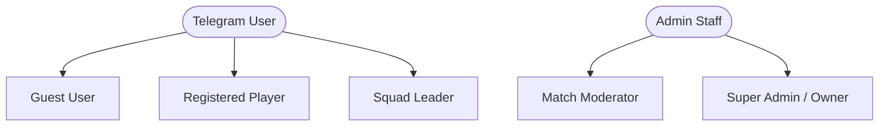

# 📄 Product Requirements Document (PRD)
## NexTournament v2.0 — Next-Gen Free Fire Esports Tournament Bot

---

### 1. Executive Summary
**NexTournament v2.0** is an enterprise-grade, high-concurrency Telegram tournament management bot engineered specifically for the Garena Free Fire competitive community. It delivers a state-of-the-art, high-performance esports platform built on Aiogram 3.15, PostgreSQL, and Redis. 

The platform automates the entire esports tournament lifecycle:
- Instant player Free Fire profile verification and anti-smurf level filtering via the live **FFxAPI** (`https://ffxinfo-ffx.ffxapis.workers.dev`).
- Multi-format match hosting (Battle Royale Solo/Duo/Squad, Clash Squad 1v1–6v6, Lone Wolf).
- Real-time slot locking and seat reservations preventing race conditions.
- High-speed async direct message (DM) distribution of Room ID and Passwords with 1-tap copyable text.
- Triple-layer match result processing: Fast-path admin input, player screenshot approval queue, and automated OCR scoreboard scanning.
- Dual-wallet architecture (`game_balance` vs `win_balance`) with instant Dynamic UPI QR code payments and OxaPay cryptocurrency integration (USDT/TRX).
- Gamified user engagement: Weekly/monthly leaderboards, referral rewards, redeem codes, daily streaks, and dynamic visual profile card generation.
- Signature **Small-Caps Gaming Typography** (`Tᴏᴜʀɴᴀᴍᴇɴᴛ Iᴅ`) with box-frame layouts and dual English/Hindi localization.

---

### 2. User Personas & Roles

#### 2.1 Player (User)
- Registers Telegram account and links Free Fire UID with real-time API verification.
- Deposits funds via Dynamic UPI QR or OxaPay Crypto.
- Browses live, upcoming, and featured tournaments.
- Joins matches in Solo mode or registers a full Duo/Squad team.
- Receives instant DM notification with Room ID & Password 10–15 minutes prior to match.
- Submits match victory screenshots for prize claims.
- Withdraws winnings seamlessly to UPI or Crypto address.
- Participates in referral programs, daily check-ins, and leaderboards.

#### 2.2 Squad / Team Leader
- Registers 2 to 6 teammates using their Free Fire UIDs.
- System validates all teammates' levels, regions, and names in parallel.
- Pays entry fee for the entire team or allocates slots.
- Receives team credentials and coordinates room entry.

#### 2.3 Match Host / Moderator (Staff)
- Creates and configures dynamic tournaments (Map, Mode, Slots, Entry Fee, Prize Pool, Gun Attributes).
- Broadcasts Room ID & Password directly to joined players.
- Approves or rejects player screenshot result submissions.
- Declares official match results, kills, and ranks.
- Can reschedule, delay, or cancel matches with automatic refund triggers.

#### 2.4 Super Admin / Owner (Executive)
- Full system authority over finances, gateway configurations, and wallet transactions.
- Manages moderator staff roles and permissions.
- Processes or audits manual withdrawal requests.
- Sends mass broadcasts to all bot users with delivery metrics.
- Manages promo codes, platform commission rates, and maintenance mode.

---

### 3. Detailed Functional Requirements

#### 3.1 Onboarding & Player Verification
| ID | Requirement | Description |
| :--- | :--- | :--- |
| **FR-ONB-01** | Force-Join Channel Verification | Users must join the official announcement channel before interacting with bot menus. Includes 1-tap `[✅ Cᴏɴғɪʀᴍ]` validation. |
| **FR-ONB-02** | Terms & Conditions Acceptance | Interactive acceptance of tournament fair-play terms. |
| **FR-ONB-03** | Free Fire UID Binding | User submits Free Fire UID (6–15 digits). Bot queries `https://ffxinfo-ffx.ffxapis.workers.dev/ffinfo?uid={uid}` to fetch IGN, Level, Region, Avatar, and Rank. |
| **FR-ONB-04** | Anti-Smurf Filter | Minimum account level requirement (configurable, default Level 25+). Rejects burner accounts. |
| **FR-ONB-05** | UID Anti-Duplication | A Free Fire UID can be bound to only one Telegram ID. Unlinking requires moderator approval or cooldown. |
| **FR-ONB-06** | Dynamic Profile Card | Generates a high-definition visual player card (PNG/WebP) with IGN, UID, Level, Rank badge, Win Rate, and Wallet balance. |

#### 3.2 Tournament Engine
| ID | Requirement | Description |
| :--- | :--- | :--- |
| **FR-TRN-01** | Dynamic Match Creation | Admin wizard to create matches with customizable parameters: Mode (BR, CS, Lone Wolf), Team Size (Solo, Duo, Squad), Map, Slots (2–48), Entry Fee, Prize Model, Start Time. |
| **FR-TRN-02** | Gun Attributes Toggle | Option to host matches with Gun Attributes *ON* or *OFF*. |
| **FR-TRN-03** | Dynamic Slot Locking | High-speed seat reservation using database row-level locking (`SELECT FOR UPDATE`) to prevent over-subscription under high traffic. |
| **FR-TRN-04** | Pinned Ticket Notification | Upon joining, bot pins a receipt in the user's private chat showing Seat Number, Match ID, and Start Time. |
| **FR-TRN-05** | Credential DM Broadcast | 10–15 minutes before the match, bot fires parallel async DMs to all joined participants containing copyable Room ID & Password with sound alert. |
| **FR-TRN-06** | Auto-Refund Engine | If a match fails to reach the minimum player threshold X minutes before start, the tournament auto-cancels and entry fees are instantly refunded to players' `game_balance`. |

#### 3.3 Prize & Match Results Processing
| ID | Requirement | Description |
| :--- | :--- | :--- |
| **FR-RES-01** | Interactive Admin Fast-Path | Admin selects tournament, enters winning seat numbers/UIDs and kills. System computes payouts and credits `win_balance` in a single ACID transaction. |
| **FR-RES-02** | Screenshot Proof Queue | Players upload end-match victory screenshots. Admins get an interactive queue with thumbnail, user details, and 1-tap `[✅ Approve]` / `[❌ Reject]` buttons. |
| **FR-RES-03** | AI/OCR Scoreboard Reader | Admin or moderator uploads match scoreboard screenshot; OCR extracts player names, positions, and kills for 1-tap automated disbursement. |
| **FR-RES-04** | Channel Victory Announcement | Once results are finalized, the bot posts an aesthetic victory banner to the public Telegram channel featuring MVP, Top Kills, and Prize Winners. |

#### 3.4 Wallet & Financial System
| ID | Requirement | Description |
| :--- | :--- | :--- |
| **FR-WAL-01** | Dual Wallet Architecture | Distinguishes between `game_balance` (deposit funds/bonuses) and `win_balance` (tournament winnings, withdrawable). |
| **FR-WAL-02** | Entry Fee Deduction Order | Entry fees deduct from `game_balance` first; any deficit is deducted from `win_balance`. |
| **FR-WAL-03** | Dynamic UPI QR Deposit | Generates real-time UPI QR codes (`upi://pay?pa=...`) with transaction reference tracking. User submits 12-digit UTR for automated verification with admin queue fallback. |
| **FR-WAL-04** | OxaPay Crypto Gateway | Seamless crypto deposits (USDT TRC20/BEP20, TRX) with automated blockchain webhooks and instant wallet crediting. |
| **FR-WAL-05** | Withdrawal Engine | Users submit withdrawal requests for `win_balance` (UPI ID or Crypto Address). Admin dashboard provides 1-tap review and payout execution. |
| **FR-WAL-06** | Financial Audit Logs | Immutable transaction log (`wallet_transactions`) recording every credit, debit, match fee, and payout. |

#### 3.5 Admin CRM & Forum Topics Automation
| ID | Requirement | Description |
| :--- | :--- | :--- |
| **FR-CRM-01** | Telegram Supergroup Forum Topics | The Staff & Logs Group (`-1004470724280`) utilizes Telegram Forum Topics for organized operational threads: Deposits, Withdrawals, Match Proofs, and User Threads. |
| **FR-CRM-02** | User Profile Cards in Staff Group | Whenever a user registers, deposits, or joins a match, an interactive user card is posted to the forum topic displaying: IGN, FF UID, Level, Region, Balances (`game_balance`, `win_balance`), and Matches Played. |
| **FR-CRM-03** | 1-Tap Interactive Admin Buttons | Every staff notification card includes interactive action buttons: `[💰 Add Fund]`, `[✂️ Cut Fund]`, `[🔒 Ban User]`, `[🔓 Unban]`, and `[✉️ Message User]`. |
| **FR-CRM-04** | Dynamic Admin Customization | Platform commission, Room ID/Pass timing (default 10m before start), and minimum level requirements are dynamically adjustable in real-time from the Admin Panel. |

#### 3.6 Gamification & Viral Growth
| ID | Requirement | Description |
| :--- | :--- | :--- |
| **FR-GAM-01** | Referral & Earn Engine | Unique referral links (`t.me/Bot?start=ref_12345`). Referrers earn bonus credits when referees deposit or play their first tournament. |
| **FR-GAM-02** | Promo & Redeem Vouchers | Admins generate single-use or multi-use promo codes (e.g. `BOOYAH50`) granting match entry discounts or wallet balance. |
| **FR-GAM-03** | Leaderboards | Weekly and Monthly leaderboards displaying Top Earners, Most Tournaments Won, and Top Killers. |
| **FR-GAM-04** | Daily Login Streak | Daily check-in reward system providing small loyalty points to maximize user retention. |

---

### 4. Non-Functional Requirements (NFR)
1. **Performance & Speed**: Response latency for callback buttons $< 150\text{ ms}$. Bulk credential broadcast to 48 players completed in $< 5\text{ seconds}$.
2. **Concurrency & Thread Safety**: 100% protection against double-spending and slot overbooking via PostgreSQL atomic transactions and Redis distributed locks.
3. **Availability & Resilience**: Designed for 99.9% uptime using Docker containerization with automatic healthcheck restarts.
4. **Security**: Environment-isolated secrets, rate-limiting on all user actions, sanitization of inputs, and anti-replay constraints on payment UTRs.
5. **Aesthetics**: Consistent Small-Caps Gaming Typography, box-frame borders, and polished emoji palettes across 100% of user-facing views.
