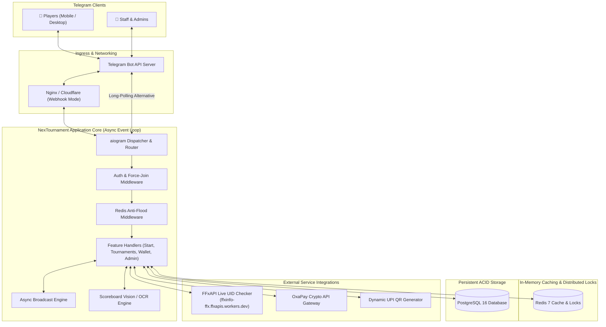
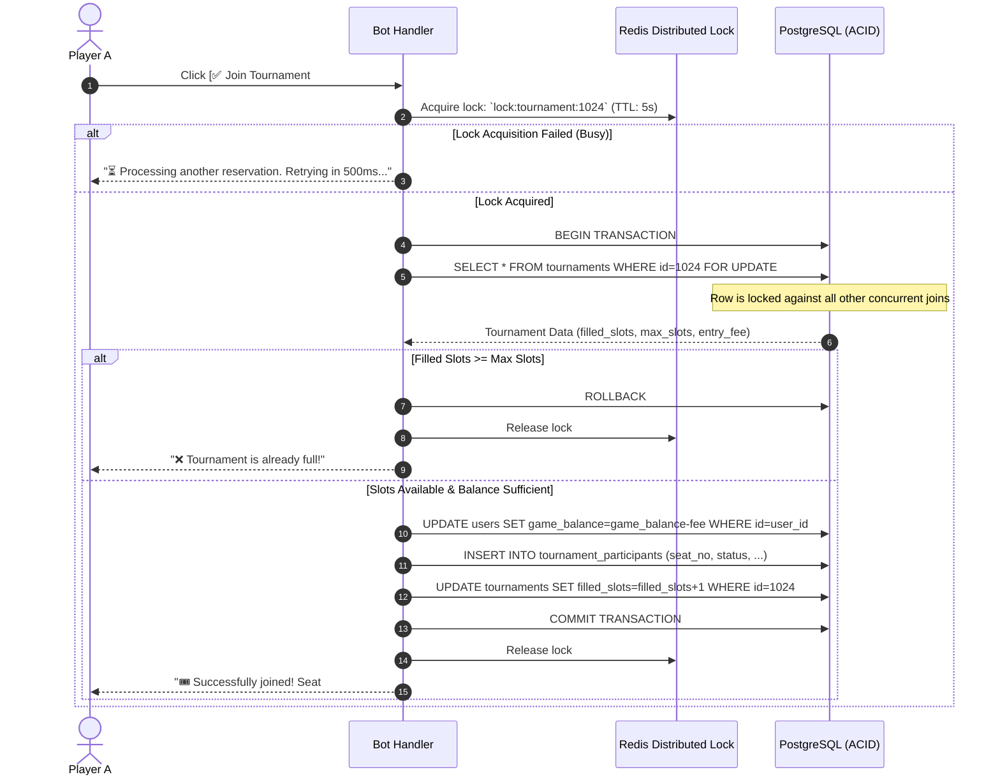
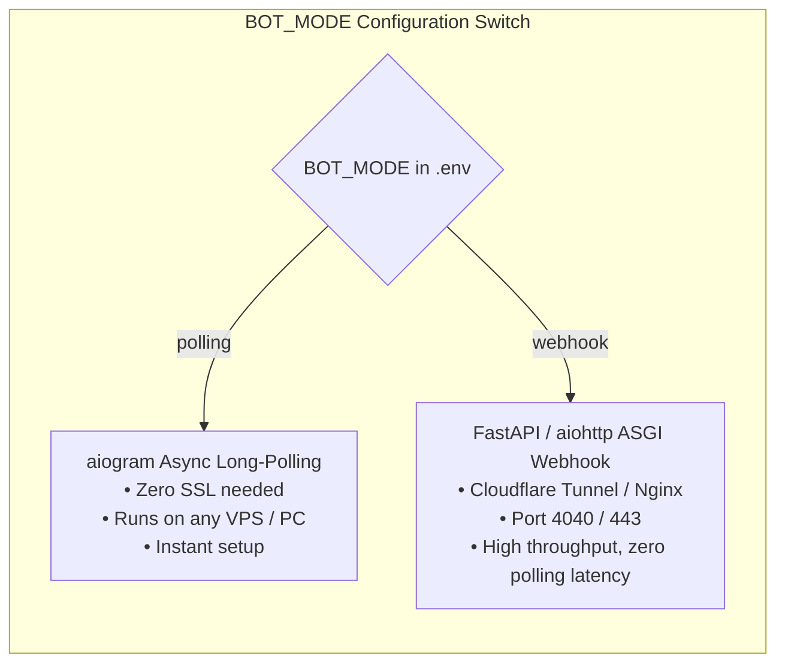
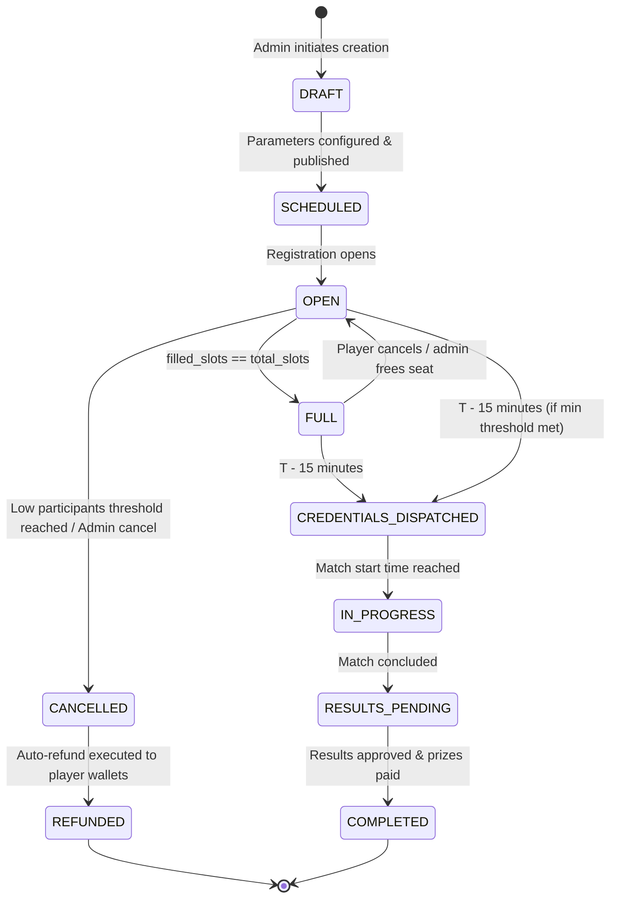
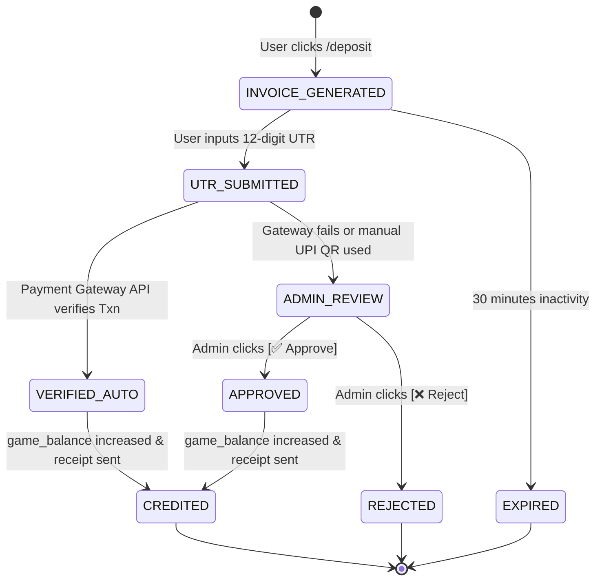
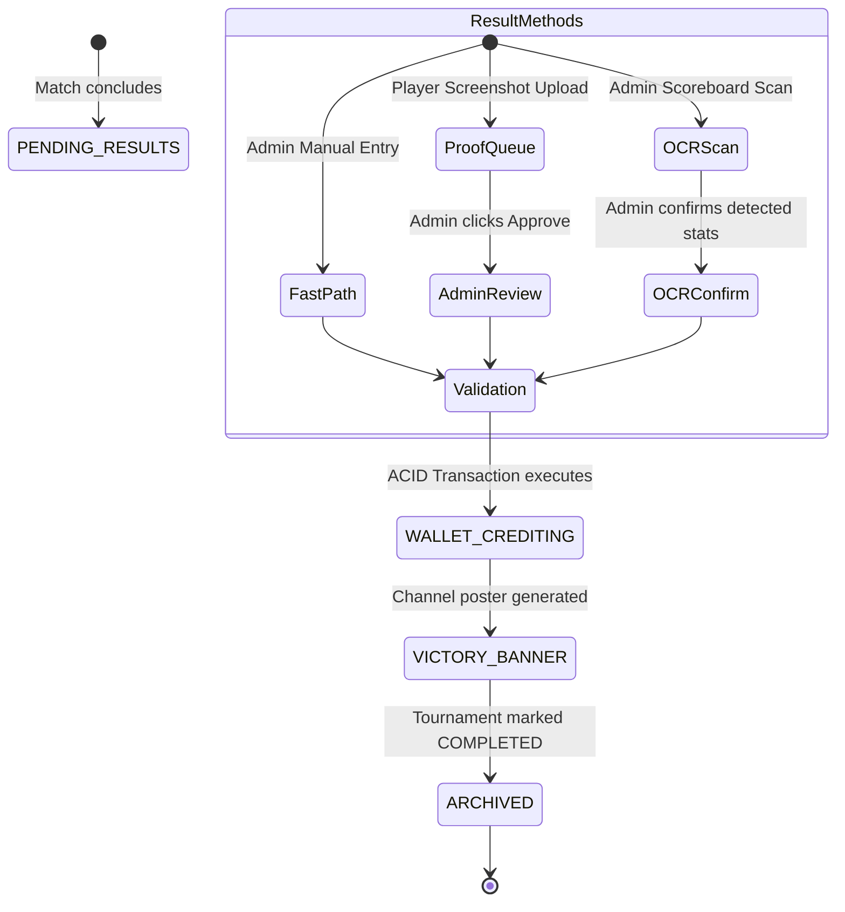

# 🏛️ System Architecture Document (SAD)
## NexTournament v2.0 — High-Concurrency Tournament Architecture

---

### 1. High-Level Architectural Overview

NexTournament v2.0 is built on an asynchronous, event-driven micro-modular pattern using **Python 3.12+**, **aiogram 3.x**, **PostgreSQL 16**, and **Redis 7**.

---

### 2. Concurrency & Slot Locking Model (Race Condition Defense)

In esports tournament drops, dozens of players click "Join Tournament" in the exact same millisecond. Traditional bot solutions often use naive list reads/writes without atomicity, which causes duplicate seat allocation and slot overbooking.

NexTournament v2.0 implements a **Dual-Layer Concurrency Defense**:

---

### 3. Dual-Mode Deployment Architecture

NexTournament v2.0 features a single-configuration switch in `.env` (`BOT_MODE=polling` vs `BOT_MODE=webhook`) to enable zero-hassle local development and enterprise production deployments.

---

### 4. Finite State Machines (FSM)

#### 4.1 Tournament Lifecycle FSM

#### 4.2 Deposit & UTR Verification FSM

#### 4.3 Triple-Layer Result Declaration FSM

---

### 5. High-Speed Direct Message (DM) Broadcast Engine

To deliver Room ID and Password to 48 players in $< 3\text{ seconds}$ without hitting Telegram's `429 Too Many Requests` flood limits:
1. **Parallel Worker Pool**: Uses `asyncio.gather` bounded by an `asyncio.Semaphore(25)`.
2. **Exponential Backoff**: Intercepts Telegram retry-after headers dynamically.
3. **Delivery Tracking**: Records per-user delivery state (`DELIVERED`, `BLOCKED`, `FAILED`) in Redis and notifies the match host immediately upon completion.
