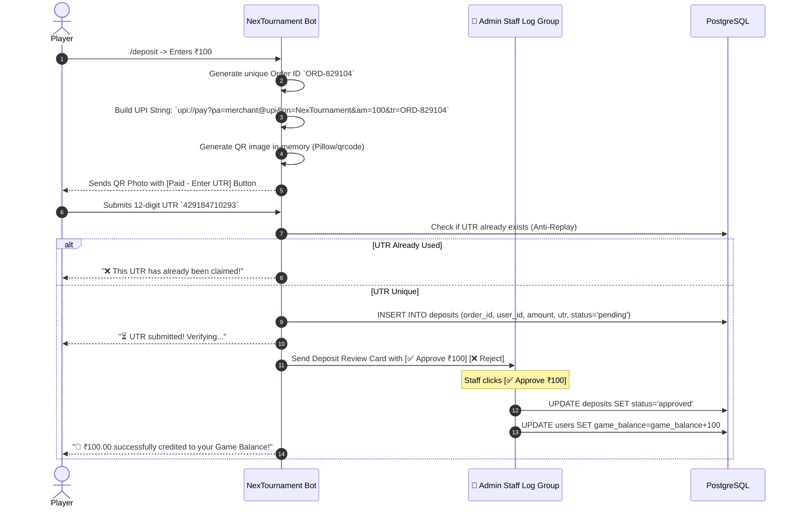

# 🔌 API Integrations Specification
## NexTournament v2.0 — External APIs & Gateway Protocols

---

### 1. Free Fire FFX API Integration (`https://ffxinfo-ffx.ffxapis.workers.dev`)

The bot integrates directly with the live **FFxAPI** edge service for Free Fire player data verification, anti-smurf checks, and dynamic profile card rendering.

#### 1.1 Specification & Endpoint Catalog
| Endpoint | Method | Params | Response Payload Highlights | Rate Limit |
| :--- | :--- | :--- | :--- | :--- |
| `/ffinfo` | `GET` | `uid`: 6–15 digits | Full profile: `identity`, `profile` (Level, Likes), `rank_info`, `guild_info`, `equipped_items` | 1 req / 5s edge client |
| `/name` | `GET` | `uid`: 6–15 digits | Rapid IGN-only response: `{"error": false, "username": "..."}` | 1 req / 5s edge client |
| `/check` | `GET` | `uid`: 6–15 digits | Fast validation check if player account exists | 1 req / 5s edge client |
| `/health`| `GET` | None | Service status check | Unrestricted |

#### 1.2 Upstream Constraints & Mitigation Architecture
- **Upstream Rate Limit**: `1 request per 5 seconds per edge client`.
- **Mitigation Strategy (Cache-Aside + Request Coalescing)**:
  1. **Redis Cache Layer**: Every successful `/ffinfo` response is cached under `cache:ffinfo:{uid}` with a **30-minute TTL**.
  2. **Fast Name Cache**: Team member names from `/name` are cached under `cache:ffname:{uid}` with a **1-hour TTL**.
  3. **Async Queue & Rate-Limiter**: When querying new UIDs not in cache, the bot's internal client enforces a 5-second sliding queue per edge client to prevent upstream 429 errors.
  4. **Circuit Breaker & Fallback**: If the API is offline or returns an error, the user is prompted to enter their IGN manually with a `[⚠️ Unverified]` badge until background verification succeeds.

#### 1.3 Sample Request & Response
```http
GET /ffinfo?uid=11510698353 HTTP/1.1
Host: ffxinfo-ffx.ffxapis.workers.dev
User-Agent: NexTournamentBot/2.0
Accept: application/json
```

```json
{
  "error": false,
  "status": 200,
  "msg": "id_found",
  "version": "V7X",
  "data": {
    "identity": {
      "uid": "11510698353",
      "username": "Mohin7KX",
      "region": "BD"
    },
    "profile": {
      "level": 51,
      "likes": 2158,
      "account_age": { "label": "1 year and 6 months" }
    },
    "rank_info": {
      "br_max_rank": 311,
      "cs_max_rank": 301
    },
    "guild_info": {
      "name": "EH-HUNTERS",
      "id": "3087017059"
    }
  }
}
```

---

### 2. OxaPay Crypto Gateway Integration

OxaPay provides automated non-custodial crypto invoicing and payouts for USDT (TRC20, BEP20) and TRX.

#### 2.1 Invoicing Flow (User Deposit)
1. User selects deposit currency (e.g. USDT-TRC20).
2. Bot requests an invoice via `POST https://api.oxapay.com/merchants/request`:
   ```json
   {
     "merchant": "YOUR_OXAPAY_MERCHANT_KEY",
     "amount": 10.0,
     "currency": "USDT",
     "network": "TRC20",
     "lifeTime": 30,
     "feePaidByPayer": 1,
     "orderId": "DEP-USER123-1727788",
     "callbackUrl": "https://yourdomain.com/api/webhooks/oxapay",
     "description": "NexTournament Deposit"
   }
   ```
3. Bot displays the designated crypto address and QR code to the user.
4. When the user transfers crypto, OxaPay verifies on-chain and triggers the webhook callback.

#### 2.2 Webhook Signature & Security
OxaPay sends a POST request with an HMAC SHA-512 signature in the header or payload:
```python
import hmac, hashlib

def verify_oxapay_signature(raw_body: bytes, signature: str, api_secret: str) -> bool:
    expected = hmac.new(api_secret.encode(), raw_body, hashlib.sha512).hexdigest()
    return hmac.compare_digest(expected, signature)
```
Upon verification, the user's `game_balance` is credited in a PostgreSQL transaction and a receipt is delivered via Telegram.

---

### 3. Dynamic UPI QR & Direct Paytm Merchant Verification Pipeline

NexTournament v2.0 implements native local QR rendering and direct official Paytm Merchant Status API verification (matching the proven pattern from `NexNum`):

#### 3.1 Paytm Merchant Verification API Specification
- **Gateway Endpoint**: `POST https://securegw.paytm.in/merchant-status/getTxnStatus`
- **Merchant ID (`MID`)**: `UWjSzy23711328951174`
- **UPI VPA**: `paytmqr281005050101nbxw0hx35cpo@paytm`
- **Request Format**: `Content-Type: application/x-www-form-urlencoded`
  ```python
  payload = "JsonData=" + urllib.parse.quote(json.dumps({
      "MID": "UWjSzy23711328951174",
      "ORDERID": order_id
  }))
  ```
- **Response Shape & Verification**:
  ```json
  {
    "STATUS": "TXN_SUCCESS",
    "RESPMSG": "Txn Success",
    "TXNAMOUNT": "100.00",
    "ORDERID": "NXM_ed1c5b_1790653714575_5F5L40",
    "BANKTXNID": "994984673006",
    "TXNDATE": "2026-09-29 09:18:53.0"
  }
  ```
- When `STATUS == "TXN_SUCCESS"` and `RESPMSG == "Txn Success"`, the bot immediately credits `game_balance` and posts a verified receipt.
- **Fallback Queue**: If user paid via third-party UPI or Paytm API is delayed, user submits their 12-digit UTR, which routes to the Admin Staff Forum Topic (`-1004470724280`) for 1-tap manual approval.



---

### 4. OCR & Vision Scoreboard Scanner

When match hosts or players upload end-match result screenshots:
1. **Preprocessing Pipeline**:
   - Contrast Enhancement (CLAHE) & Grayscale normalization.
   - Bilateral filtering to reduce Free Fire HUD compression artifacts.
2. **Text Extraction**:
   - Tesseract OCR (with Free Fire font training parameters) or Vision API parses:
     - Placement / Rank (#1 BOOYAH, #2, #3, etc.)
     - Player In-Game Names (IGNs)
     - Total Kills
     - Total Damage
3. **Fuzzy String Matching**:
   - Matches parsed OCR names against registered tournament participants' `ff_ign` using Levenshtein distance ($\ge 85\%$ confidence).
4. **Admin Confirmation**:
   - Displays a structured preview table to the admin with 1-tap confirmation:
   `[🏆 1st: Mohin7KX (8 Kills) | 2nd: Orbit (4 Kills) | 3rd: Hunter (2 Kills)]`
   `[✅ Confirm & Disburse ₹500]`
