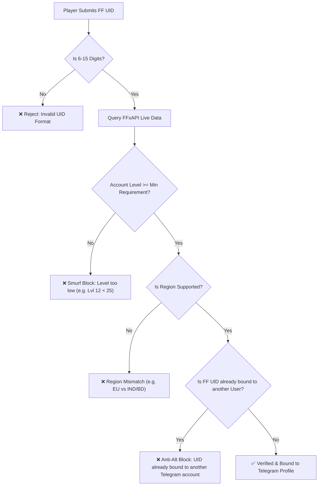

# 🛡️ Security, Anti-Cheat & Anti-Fraud Architecture
## NexTournament v2.0 — Platform Integrity & Risk Mitigation

---

### 1. Hardcoded Credentials Elimination

In insecure bot scripts, admin IDs and tokens are often dangerously hardcoded:
```python
# Vulnerable Insecurity Example:
admin = []
admin.append('5716978793')
admin.append('1489381549')
admin.append('1889471360')
admin.append('5623593066')
Bot.saveData("Bot:Admins", admin)
```

**NexTournament v2.0 Rule**: Zero hardcoded IDs or secrets.
- All secrets, API keys, tokens, and default SuperAdmin IDs are loaded securely from `.env` via **Pydantic Settings v2**.
- Sub-admins and moderators are managed dynamically in the PostgreSQL `users` table via role permissions (`user_role`).

---

### 2. Anti-Smurf & Anti-Cheat Player Integrity

Competitive Free Fire tournaments are frequently targeted by smurfs (high-skill players creating brand-new accounts) or cheaters using script tools on disposable accounts.



---

### 3. Financial Security & Balance Invariants

To eliminate double-spending, negative balances, and unauthorized minting of funds:

#### 3.1 Strict Database Constraints
- Both `game_balance` and `win_balance` have non-negative check constraints:
  ```sql
  CHECK (game_balance >= 0)
  CHECK (win_balance >= 0)
  ```
- Any operation that would drive a balance below zero fails at the database engine level and triggers a rollback.

#### 3.2 UTR & Payment Anti-Replay Defense
- Every payment UTR and Crypto Transaction ID has a database `UNIQUE` constraint.
- Attempting to submit a previously recorded UTR immediately aborts with an alert:
  `"❌ This transaction reference has already been claimed."`

#### 3.3 Platform Solvency Invariant Audit
A scheduled nightly worker validates platform solvency:
$$\sum \text{Users' Balances} \equiv \sum \text{Approved Deposits} + \sum \text{Bonuses} - \sum \text{Approved Withdrawals} - \text{Platform Profit}$$
If any deviation $> ₹0.00$ is detected, the bot automatically enables **Maintenance Mode** and sends an emergency alert to the SuperAdmin group.

---

### 4. Anti-Flood & Rate Limiting Middleware

To prevent button spamming, denial-of-service, or automated script attacks, an async Redis sliding-window middleware is enforced on all incoming updates:

```python
class AntiFloodMiddleware:
    def __init__(self, redis_client, limit_per_sec: int = 5):
        self.redis = redis_client
        self.limit = limit_per_sec

    async def __call__(self, handler, event, data):
        user_id = event.from_user.id
        key = f"ratelimit:{user_id}"
        
        current = await self.redis.incr(key)
        if current == 1:
            await self.redis.expire(key, 1)
        elif current > self.limit:
            if current == self.limit + 1:
                await event.answer("⚠️ Please don't click rapidly! Server load protection active.", show_alert=True)
            return
            
        return await handler(event, data)
```

---

### 5. Role-Based Access Control (RBAC) Matrix

| Feature / Action | Player | Moderator | Admin | SuperAdmin |
| :--- | :---: | :---: | :---: | :---: |
| Join Matches & Reserve Seats | ✅ | ✅ | ✅ | ✅ |
| Deposit Funds & Request Withdrawals | ✅ | ✅ | ✅ | ✅ |
| Submit Victory Proof Screenshot | ✅ | ✅ | ✅ | ✅ |
| Create Dynamic Tournaments | ❌ | ✅ | ✅ | ✅ |
| Broadcast Room ID & Password | ❌ | ✅ | ✅ | ✅ |
| Fast-Path Result Entry & OCR Confirm | ❌ | ✅ | ✅ | ✅ |
| Approve / Reject Screenshot Proofs | ❌ | ✅ | ✅ | ✅ |
| Approve / Reject UPI & Crypto Deposits | ❌ | ❌ | ✅ | ✅ |
| Process Withdrawals & Disburse Payouts | ❌ | ❌ | ✅ | ✅ |
| Manage Staff Roles (Add/Remove Mods) | ❌ | ❌ | ❌ | ✅ |
| Mass User Broadcast | ❌ | ❌ | ✅ | ✅ |
| Financial Audits & Emergency Maintenance | ❌ | ❌ | ❌ | ✅ |
