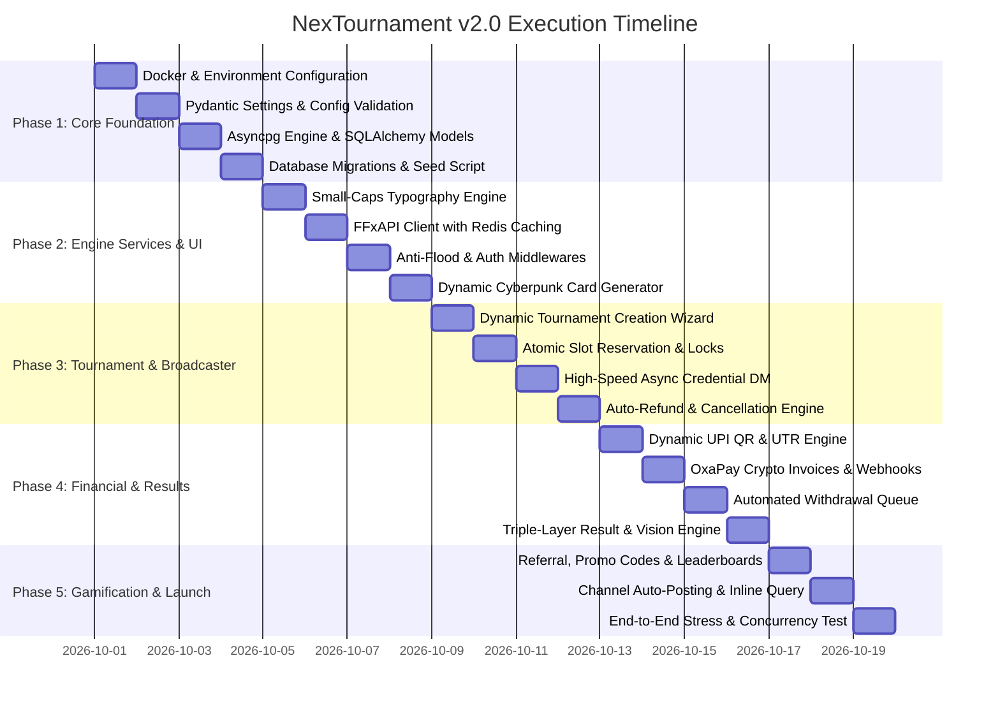

# 📋 Master Implementation Plan & Granular TODO List
## NexTournament v2.0 — Engineering Roadmap & Execution Tracker

---

### 1. Phased Roadmap Overview

---

### 2. Detailed Task Breakdown & TODO Checklist

#### 🧱 Phase 1: Core Foundation & Database Infrastructure
- [x] **Task 1.1: Dependency & Container Manifests**
  - [x] Create [requirements.txt](file:///d:/Nex-Projects/NexTournament/requirements.txt) with pinned production versions (`aiogram==3.15.0`, `asyncpg==0.30.0`, `SQLAlchemy==2.0.36`, `redis==5.2.0`, `pydantic-settings==2.6.1`, `pillow==11.0.0`, `google-genai==0.1.1`, `aiohttp==3.11.7`, `qrcode[pil]==8.0`).
  - [x] Create production [Dockerfile](file:///d:/Nex-Projects/NexTournament/Dockerfile) based on `python:3.12-slim`.
  - [x] Create [docker-compose.yml](file:///d:/Nex-Projects/NexTournament/docker-compose.yml) with `postgres:16-alpine`, `redis:7-alpine`, and `bot` services.
  - [x] Create [.env.example](file:///d:/Nex-Projects/NexTournament/.env.example) documenting all mandatory and optional environment keys.
- [x] **Task 1.2: Application Configuration Layer**
  - [x] Implement [src/config.py](file:///d:/Nex-Projects/NexTournament/src/config.py) using `pydantic_settings.BaseSettings`.
  - [x] Enforce environment validation for bot token, database URL, Redis URL, admin IDs, channel IDs, and gateway credentials.
- [x] **Task 1.3: Asynchronous Database Layer**
  - [x] Implement [src/database/connection.py](file:///d:/Nex-Projects/NexTournament/src/database/connection.py) creating an async engine with `asyncpg` connection pooling (`min_size=5`, `max_size=20`).
  - [x] Implement [src/database/models.py](file:///d:/Nex-Projects/NexTournament/src/database/models.py) defining full SQLAlchemy 2.0 mapped models:
    - [x] `User` (with dual balances: `game_balance`, `win_balance`).
    - [x] `Tournament` (with dynamic modes, slots, maps, gun attributes, prize model).
    - [x] `TournamentParticipant` (seat number unique constraint, team name, squad JSONB).
    - [x] `MatchResult` (ranks, kills, prize won).
    - [x] `ResultProof` (screenshot file ID, status, approval metadata).
    - [x] `Deposit` (order ID, gateway, UTR unique index, crypto metadata).
    - [x] `Withdrawal` (amount, method, destination, status, txid).
    - [x] `WalletTransaction` (immutable ledger of all credits and debits).
    - [x] `RedeemCode` & `RedeemCodeUsage`.
    - [x] `ReferralReward`.
  - [x] Implement database initialization script [src/database/init_db.py](file:///d:/Nex-Projects/NexTournament/src/database/init_db.py) to auto-create tables and apply constraints.

---

#### ⚙️ Phase 2: Engine Services, Middlewares & UI Utilities
- [ ] **Task 2.1: Small-Caps Typography & Localization**
  - [ ] Implement `src/utils/typography.py` with algorithmic `to_small_caps()` string transformation.
  - [ ] Implement `src/utils/i18n.py` providing seamless dictionary lookups for English (`en`) and Hindi (`hi`).
  - [ ] Implement `src/utils/keyboards.py` for persistent Main Reply Keyboard, Admin Reply Keyboard, and dynamic Inline Keyboards.
- [ ] **Task 2.2: Live Free Fire API Client (`FFxAPI`)**
  - [ ] Implement `src/services/freefire_api.py` targeting `https://ffxinfo-ffx.ffxapis.workers.dev`:
    - [ ] Redis cache-aside implementation (`cache:ffinfo:{uid}` 30m TTL, `cache:ffname:{uid}` 1h TTL).
    - [ ] 5-second per-client rate limiter conforming to edge service constraints.
    - [ ] Parse normalized fields: `username`, `level`, `region`, `likes`, `br_max_rank`, `cs_max_rank`, `avatar_id`.
    - [ ] Anti-smurf level validation (`level >= MIN_FF_LEVEL_REQUIRED`).
    - [ ] Circuit-breaker fallback if edge API encounters network interruptions.
- [ ] **Task 2.3: Security Middlewares**
  - [ ] Implement `src/middlewares/auth.py`:
    - [ ] Enforces Telegram channel force-join check with cached status.
    - [ ] Enforces global ban list check.
  - [ ] Implement `src/middlewares/rate_limit.py`:
    - [ ] Redis-backed sliding-window anti-flood limiter (max 5 events/sec per user).
- [ ] **Task 2.4: Dynamic Cyberpunk Profile Card Generator**
  - [ ] Implement `src/services/card_generator.py` using Pillow:
    - [ ] Generates neon cyberpunk dark graphics (800x450).
    - [ ] Composites player avatar, IGN, UID, Level badge, Rank badge, and win stats.

---

#### 🏆 Phase 3: Dynamic Tournaments & Credential Broadcaster
- [ ] **Task 3.1: Admin Match Creation Wizard**
  - [ ] Implement `src/handlers/admin/create_match.py` FSM wizard:
    - [ ] Match Mode selector: Battle Royale (Solo/Duo/Squad), Clash Squad (1v1–6v6), Lone Wolf.
    - [ ] Map selector: Bermuda, Purgatory, Alpine, NexTerra, Kalahari.
    - [ ] Gun Attributes toggle: ON / OFF.
    - [ ] Slot count input: 2 to 48 slots.
    - [ ] Entry Fee & Prize Pool model: Dynamic scaling, Fixed guaranteed, or Winner-Takes-All.
    - [ ] Organizer Commission %: Configurable (10%–30%).
    - [ ] Start time selector with Asia/Kolkata timezone normalization.
- [ ] **Task 3.2: High-Speed Seat Reservation Engine**
  - [ ] Implement `src/handlers/tournament.py`:
    - [ ] Tournament browser with category tabs (All, Solo, Squad, Clash Squad).
    - [ ] Dual-layer concurrency lock: Redis mutex `lock:tournament:{id}` + PostgreSQL `SELECT ... FOR UPDATE`.
    - [ ] Dual-wallet deduction: deduct from `game_balance` first, then `win_balance`.
    - [ ] Pinned ticket receipt in player's private chat.
- [ ] **Task 3.3: High-Speed Async Credential DM Broadcaster**
  - [ ] Implement `src/handlers/admin/broadcast.py`:
    - [ ] Interactive modal for host to input `RoomID:Password`.
    - [ ] Asynchronous parallel direct messaging via bounded semaphores to all joined participants.
    - [ ] 1-tap copyable monospace formatting with sound notification.
- [ ] **Task 3.4: Auto-Refund & Cancellation Engine**
  - [ ] Scheduled background task monitoring upcoming matches.
  - [ ] If participant threshold not met at T-15 minutes, auto-cancels match, refunds 100% of fees to `game_balance`, and notifies players.

---

#### 💳 Phase 4: Wallets, Multi-Gateway Payments & Approval Queues
- [x] **Task 4.1: Dynamic Currency & Exchange Rate Service**
  - [x] Live USDT/INR rate with +2.0% buffer and 10-minute Redis caching (`src/services/currency_service.py`).
  - [x] Resilient fallback rate (₹90.00) on external network disconnect.
- [x] **Task 4.2: Atomic Dual-Wallet Ledger & Concurrency Engine**
  - [x] Strict row-level locking (`SELECT ... FOR UPDATE`) in `src/services/wallet_service.py`.
  - [x] Dual-wallet isolation: `game_balance` (non-withdrawable) vs `win_balance` (100% withdrawable).
  - [x] Cascading tournament entry fee deduction (game_balance first, then win_balance).
  - [x] Immutable audit ledger (`wallet_transactions`) for every credit and debit.
- [x] **Task 4.3: Paytm Dynamic 16:9 QR Card & Deposit FSM**
  - [x] RFC-compliant UPI payment link generator (`src/services/paytm_service.py`).
  - [x] 16:9 Widescreen (`1280x720 px`) dynamic payment card generator in Electric Lime (`#CCFF00`) and Cyber Dark Slate (`#0B0E14`).
  - [x] FSM deposit flow (`src/handlers/deposit.py`) with 12-digit UTR validation.
  - [x] 3-Strike anti-fraud warning system (locks deposit for 24h on Strike 3).
  - [x] Hybrid approval: `< ₹500` instant auto-credit; `≥ ₹500` screenshot staff verification.
- [x] **Task 4.4: OxaPay Crypto Gateway & Webhook Server**
  - [x] White-label crypto invoices for USDT (TRC20, BEP20) and TRX (`src/services/oxapay_service.py`).
  - [x] Integrated `aiohttp` HTTP webhook listener (`src/services/webhook_server.py`) on port 4040.
  - [x] HMAC-SHA512 webhook signature verification and 1-confirmation auto-credit.
  - [x] Crypto deposit FSM (`src/handlers/deposit_crypto.py`).
- [x] **Task 4.5: Withdrawal Pipeline (UPI & Crypto)**
  - [x] Minimum threshold enforcement (**₹100.00**) and **0% Platform Fee** (`src/handlers/withdraw.py`).
  - [x] Daily withdrawal cap validation (**₹10,000.00**).
  - [x] Dual dispatch: Manual staff queue for UPI; automated instant API dispatch for Crypto.
  - [x] Atomic hold on `win_balance` during pending withdrawals.
- [x] **Task 4.6: Staff 1-Tap Supergroup Approval Queue**
  - [x] 1-Tap `[Approve]` and `[Reject]` callbacks in Staff Supergroup (`src/handlers/admin/approvals.py`).
  - [x] Automatic user DM notifications and instant refunds on rejection.
- [x] **Task 4.7: Automated Phase 4 Test Suite**
  - [x] 8 new automated unit & integration tests in `tests/test_phase4_wallet.py` passing 100%.
  - [x] Full regression test suite (19/19 tests) passing 100%.

---

#### 🚀 Phase 5: AI Vision, Proof Verification, Cancellation & Gamification
- [x] **Task 5.1: Gemini Cloud AI Vision Scoreboard Scanner**
  - [x] Multimodal OCR parser (`src/services/vision_ocr.py`) with hybrid fallback (`gemini-2.5-flash` to `gemini-2.5-pro` if confidence < 85%).
  - [x] Fuzzy participant IGN matching and automated prize calculations (50/35/15 BR and CS MVP).
- [x] **Task 5.2: Player Match Proof Submission Queue & Disputes**
  - [x] Post-match screenshot submission flow (`src/handlers/proof_submission.py`) with 15-minute deadline.
  - [x] Anti-duplication and conflicting rank claim dispute freezes routed to Staff `#Match-Proof` topic.
- [x] **Task 5.3: T-10 Minute Auto-Cancellation & 100% Refund Worker**
  - [x] Background worker (`src/services/cancellation_worker.py`) scanning matches at T-10 minutes.
  - [x] 50% occupancy rule: auto-cancels match and refunds 100% of entry fees to `game_balance`.
- [x] **Task 5.4: Match-Triggered Referral Engine & Daily Mystery Box**
  - [x] Referral deep link generator (`src/services/referral_service.py` & `src/handlers/referral.py`).
  - [x] Match-triggered referral reward: ₹10 to Referrer and ₹5 to Friend upon completing 1st paid match.
  - [x] 7-day Mystery Box streak system (`src/handlers/daily_bonus.py`) with ₹1–₹5 daily and guaranteed ₹10 Day 7 jackpot.
- [x] **Task 5.5: Promo & Redeem Code Engine**
  - [x] Single-use per player voucher engine (`src/services/redeem_service.py` & `src/handlers/redeem.py`).
  - [x] Admin `/create_code` command and usage limit enforcement.
- [x] **Task 5.6: Esports Leaderboards Portal**
  - [x] Dynamic Weekly and All-Time leaderboards (`src/handlers/leaderboard.py`) for Top Earners and Top Killers.
- [x] **Task 5.7: Automated Phase 5 Test Suite**
  - [x] 6 new automated tests in `tests/test_phase5_features.py` passing 100%.
  - [x] Full regression test suite (25/25 tests across all phases) passing 100%.

---

#### 🌐 Phase 6: Production Deployment, Worker Supervisor & Live Launch
*Detailed Blueprint: [docs/14_PHASE_6_IMPLEMENTATION_PLAN.md](file:///d:/Nex-Projects/NexTournament/docs/14_PHASE_6_IMPLEMENTATION_PLAN.md)*
- [x] **Task 6.1: User Onboarding, Profile & Navigation Router** (`src/handlers/start.py`)
  - [x] `/start` deep links (`ref_{id}`, `tourn_{id}`) and persistent main reply keyboard.
  - [x] Player profile view (`/profile`, `👤 Profile`) with 16:9 profile card generator.
  - [x] Free Fire UID verification FSM (`/link_uid`) with Level ≥ 25 validation via `FreeFireAPIService`.
  - [x] System status (`/status`) and customer support (`/support`).
- [x] **Task 6.2: Master Application Supervisor** (`src/main.py`)
  - [x] Dual-mode runner: Long Polling (development) & Telegram Webhook (production).
  - [x] Supervised `TournamentCancellationWorker` 60s heartbeat task.
  - [x] Integrated `aiohttp` web server on port 4040 handling OxaPay IPNs and `/health` probes.
  - [x] Aiogram Dispatcher with strict `RedisStorage` connectivity assertion.
  - [x] Middlewares (`AuthMiddleware`, `RateLimitMiddleware`) and command menu synchronization.
  - [x] Uncaught exception handler forwarding tracebacks to `#Bot-Logs` in Staff Supergroup.
  - [x] Graceful termination handling (`SIGINT`, `SIGTERM`) with clean connection pool disposal.
- [x] **Task 6.3: Production Docker & Compose Orchestration**
  - [x] Verify `Dockerfile` font packages, libpq, and build optimizations.
  - [x] Verify `docker-compose.yml` healthchecks for PostgreSQL 16, Redis 7, and Bot container (`/health`).
- [x] **Task 6.4: End-to-End Operational Verification Test Suite**
  - [x] `tests/test_phase6_production.py` validating app lifecycle, health probe, deep linking, UID linking, and clean teardown (7/7 passed).
  - [x] Full regression test suite passing 100% (32/32 tests passed).
