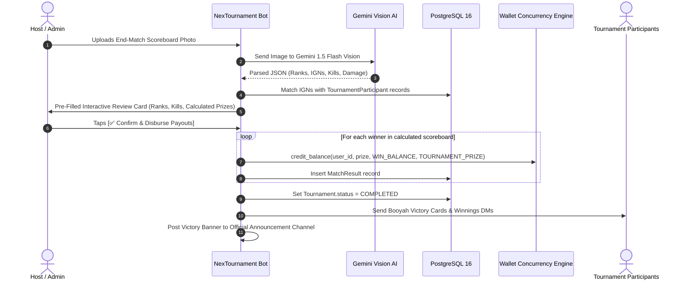

# 🏆 Phase 5 Comprehensive Implementation Plan & Granular TODO
## NexTournament v2.0 — Cloud AI Vision Scoreboard Scanner, Proof Verification, Cancellation Engine & Gamification

---

### 1. Executive Summary & Architectural Scope

Phase 5 equips **NexTournament v2.0** with autonomous verification, automated match lifecycle management, player dispute resolution, and growth/gamification mechanics:

1. **Cloud AI Vision Scoreboard Scanner (`src/services/vision_ocr.py`)**:
   - Multimodal OCR utilizing Google Gemini Vision API (`gemini-1.5-flash`).
   - Ingests end-game Free Fire screenshots from Battle Royale (Solos/Squads) and Clash Squad matches.
   - Extracts:
     - Final team/player rankings (Rank #1 Booyah, Rank #2, etc.).
     - Player In-Game Names (IGNs) and kill statistics.
     - Team scorelines (e.g. 4-2 in Clash Squad).
   - Cross-references parsed IGNs with `TournamentParticipant` records in the database.
   - **Supervised AI Mode (User Approved)**: Generates a pre-filled interactive review card for the Host/Admin with 1-tap `[✅ Confirm & Disburse Payouts]`, eliminating manual data entry while preventing AI misreads.
2. **Player Match Proof Submission Queue (`src/handlers/proof_submission.py`)**:
   - Post-match DM portal for players to submit victory/kill screenshots.
   - Captures `ResultProof` records (`file_id`, `claimed_rank`, `claimed_kills`, `status=PENDING`).
   - Routes proof cards to the Staff Supergroup `#Match-Proof` Topic with player telemetry and 1-tap `[✅ Accept]` / `[❌ Reject]` buttons.
   - Anti-duplication guards prevent multiple submissions from the same team.
3. **T-10 Minute Auto-Cancellation & 100% Refund Worker (`src/services/cancellation_worker.py`)**:
   - Background worker running on a 60-second heartbeat.
   - Scans matches where `start_time - now <= 10 minutes` and `status == OPEN`.
   - **50% Slot Rule (User Approved)**: If `occupied_slots / total_slots < 0.50`, automatically triggers cancellation.
   - Reverts match status to `CANCELLED`.
   - Calls `WalletService.credit_balance` with `balance_type=GAME_BALANCE` and `tx_type=TOURNAMENT_REFUND` for 100% of collected entry fees.
   - Sends batch DMs to all affected players informing them of the refund.
   - Emits cancellation notice to the official channel and `#Bot-Logs`.
4. **Match-Triggered Referral Reward Engine (`src/services/referral_service.py` & `src/handlers/referral.py`)**:
   - Unique deep-link generation: `https://t.me/{bot_username}?start=ref_{telegram_id}`.
   - Stores `user.referrer_id` upon initial start.
   - **Match-Triggered Rule (User Approved)**: When the referred user completes their 1st paid tournament, automatically credits:
     - **Referrer**: **₹10.00** to `game_balance`.
     - **Friend (Referee)**: **₹5.00** to `game_balance`.
     - Records immutable transaction in `wallet_transactions` and `referral_rewards`.
     - Sends celebratory DM notifications to both parties.
5. **Daily Check-in Streaks & Gamification (`src/handlers/daily_bonus.py`)**:
   - `/daily` command and `🎁 Daily Bonus` reply button.
   - 7-day escalating streak rewards credited to `game_balance`.
   - Tracks last claim timestamp and streak count.
6. **Promo & Redeem Code Engine (`src/services/redeem_service.py` & `src/handlers/redeem.py`)**:
   - `/redeem <code>` command.
   - Validates `RedeemCode` usage limits, expiry, and single-use per user in `RedeemCodeUsage`.
   - Admin command `/create_code <code> <amount> <uses> <days>` for instant voucher generation.
7. **Esports Leaderboards & Player Stats (`src/handlers/leaderboard.py`)**:
   - `/leaderboard` command with categories:
     - Top Tournament Winners (Highest net prize earnings).
     - Top Fraggers (Most verified kills).
     - Most Matches Played.
   - Rendered using Unicode box framing and small-caps typography.

---

### 2. Confirmed Configuration Rules (All User-Approved)

1. **AI Vision Architecture & Model Selection**:
   - **Hybrid Fallback Engine**: Attempts OCR with `gemini-1.5-flash` for ultra-fast response (< 2s). If confidence score is `< 85%` or text is ambiguous, automatically retries with `gemini-1.5-pro` for deep multimodal reasoning before falling back to manual entry.
2. **Player Match Proof Submission Window**:
   - **15-Minute Window**: Participants have exactly 15 minutes post-match to submit their screenshot proofs. The queue closes automatically at T+15m to guarantee fast winner settlement.
3. **Dispute Resolution & Anti-Cheat**:
   - **Automatic Freeze & Moderator Alert**: If conflicting proofs are submitted (e.g. multiple teams claiming 1st place Booyah), payouts are frozen, tagged as `DISPUTED`, and immediately routed to the Staff Supergroup `#Match-Proof` topic with an alert for manual staff resolution.
4. **Daily Check-in Streak Rewards**:
   - **Mystery Box Gamification**: Daily check-in gives a random reward between **₹1.00 and ₹5.00** into `game_balance`, with a **guaranteed ₹10.00 jackpot** upon completing the 7-day streak.
5. **Esports Leaderboards Cadence**:
   - **Weekly & All-Time Dual Board**: Rolling weekly leaderboards (resetting every Sunday at 23:59 IST) for active top fraggers & earners, paired with a permanent All-Time Hall of Fame.
6. **Auto-Cancellation & Refund Threshold**:
   - **T-10 Minute Auto-Cancel**: If `< 50%` of match seats are occupied 10 minutes before start time, the scheduler cancels the match and executes 100% automated fee refunds to `game_balance`.
7. **Referral Rewards**:
   - **Match-Triggered Reward**: Referrer receives **₹10.00** and Friend receives **₹5.00** credited to `game_balance` immediately after the friend completes their 1st paid tournament.

---



---

### 3. State Machines & Finite State Workflows

#### A. Player Proof Submission FSM (`ProofSubmissionStates` in `src/handlers/proof_submission.py`)
1. `SELECT_TOURNAMENT`:
   - Lists recently completed tournaments in which the player participated (last 60 mins).
2. `ENTER_CLAIMED_STATS`:
   - Prompts player for their claimed placement/rank and total kills.
3. `UPLOAD_SCREENSHOT`:
   - Captures `photo[-1].file_id`.
   - Creates `ResultProof(tournament_id=..., user_id=..., file_id=..., status='pending')`.
   - Forwards proof card with player stats to Staff Supergroup `#Match-Proof` Topic with `[✅ Accept]` and `[❌ Reject]` buttons.

#### B. Promo Code Redeem FSM (`RedeemStates` in `src/handlers/redeem.py`)
1. `ENTER_CODE`:
   - Validates code syntax and alphanumeric format.
   - Checks `RedeemCode` in database: active, not expired, `current_uses < max_uses`.
   - Checks `RedeemCodeUsage` to ensure user hasn't already redeemed this code.
   - Credits reward to `game_balance` and increments `current_uses`.

---

### 4. Granular Task Checklist for Phase 5

```
Phase 5 Task Hierarchy
├── 🤖 Task 5.1: Gemini Cloud AI Vision Scoreboard Scanner [src/services/vision_ocr.py]
├── 📸 Task 5.2: Player Match Proof Submission Queue [src/handlers/proof_submission.py]
├── ⏱️ Task 5.3: T-10 Minute Auto-Cancellation & Refund Engine [src/services/cancellation_worker.py]
├── 🤝 Task 5.4: Match-Triggered Referral Engine & Daily Streaks [src/services/referral_service.py & src/handlers/referral.py & src/handlers/daily_bonus.py]
├── 🎟️ Task 5.5: Promo & Redeem Code Engine [src/services/redeem_service.py & src/handlers/redeem.py]
├── 🏆 Task 5.6: Esports Leaderboards Portal [src/handlers/leaderboard.py]
└── 🧪 Task 5.7: Comprehensive Automated Phase 5 Test Suite [tests/test_phase5_*.py]
```

#### Detailed Breakdown:

- [ ] **Task 5.1: Gemini Cloud AI Vision Scoreboard Scanner (`src/services/vision_ocr.py`)**
  - Integrate Gemini Vision API via `google-genai` / HTTP API with `settings.GEMINI_API_KEY`.
  - Structured output prompt: Extracts `rank`, `team_name`, `players: [{ign, kills, damage}]`, `match_type`.
  - Fallback logic: If API key is empty or API unavailable, provides deterministic manual entry mode.
  - Integration with `src/handlers/admin/results.py`: Pre-populates match scoreboard draft for 1-tap host approval.

- [ ] **Task 5.2: Player Match Proof Submission Queue (`src/handlers/proof_submission.py`)**
  - Command `/submit_proof` and inline match card action `[📸 Submit Proof]`.
  - Captures `ResultProof` record in database.
  - Routes proof photo and claimed stats to Staff Supergroup `#Match-Proof` Topic.
  - Staff callbacks: `[✅ Accept Proof]` / `[❌ Reject Proof]`.

- [ ] **Task 5.3: T-10 Minute Auto-Cancellation & Refund Engine (`src/services/cancellation_worker.py`)**
  - Asynchronous background worker (`asyncio.create_task`).
  - Scans `Tournament` records where `start_time <= now + 10 mins` and `status == OPEN`.
  - If `< 50%` slots filled, updates status to `CANCELLED`.
  - Automatically refunds 100% of entry fees to all joined players' `game_balance` using `WalletService.credit_balance`.
  - Sends direct cancellation DM to all participants.
  - Logs event in `#Bot-Logs` topic and announcement channel.

- [ ] **Task 5.4: Match-Triggered Referral Engine & Daily Streaks (`src/services/referral_service.py` & `src/handlers/referral.py` & `src/handlers/daily_bonus.py`)**
  - Generate personalized referral links: `t.me/{bot}?start=ref_{user_id}`.
  - Store referral relationship in `User.referrer_id`.
  - Trigger referral payout upon referee completing 1st paid match:
    - ₹10.00 to Referrer's `game_balance`.
    - ₹5.00 to Referee's `game_balance`.
    - Logs `ReferralReward` and `WalletTransaction`.
  - Daily check-in system (`/daily`):
    - 7-day streak tracker via Redis key `streak:{user_id}` and `last_daily:{user_id}`.
    - Escalating reward ladder credited to `game_balance`.

- [ ] **Task 5.5: Promo & Redeem Code Engine (`src/services/redeem_service.py` & `src/handlers/redeem.py`)**
  - Player command `/redeem <code>`.
  - Admin command `/create_code <code> <amount> <max_uses> <days>`.
  - Database persistence in `RedeemCode` and `RedeemCodeUsage`.
  - Credits `game_balance` with immutable audit log.

- [ ] **Task 5.6: Esports Leaderboards Portal (`src/handlers/leaderboard.py`)**
  - Command `/leaderboard` and reply button `🏆 Leaderboard`.
  - Top Winners: Aggregates `sum(MatchResult.prize_won)` grouped by user.
  - Top Fraggers: Aggregates `sum(MatchResult.kills)` grouped by user.
  - Formatted in Unicode tables with small-caps titles.

- [ ] **Task 5.7: Automated Phase 5 Test Suite (`tests/test_phase5_*.py`)**
  - Test Gemini OCR response parser and participant IGN matching.
  - Test T-10 auto-cancellation worker and 100% fee refund accounting.
  - Test match-triggered referral reward allocation and duplicate referral prevention.
  - Test redeem code single-use, max usage limits, and expiry validation.
  - Test daily check-in streak logic and reset conditions.

---

### 5. Integration Touchpoints with Phase 6 & Operations

| Component | Target Phase | Description |
| :--- | :--- | :--- |
| **Worker Supervisor** | **Phase 6 / Launch** | Cancellation worker started inside the main bot lifecycle in `main.py`. |
| **Channel Broadcasts** | **Phase 6 / Launch** | Victory banners and cancellation alerts broadcast directly to `settings.MAIN_CHANNEL_ID`. |
| **Admin Controls** | **Phase 6 / Launch** | Comprehensive admin dashboard for live match overrides, user ban management, and redeem code creation. |
