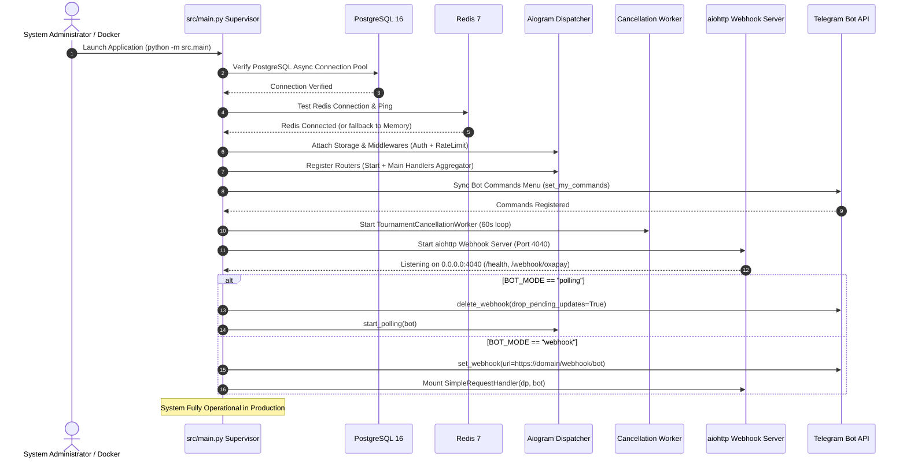
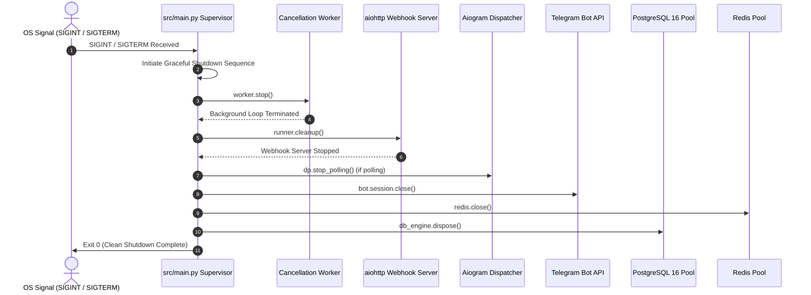

# 🚀 Phase 6 Comprehensive Implementation Plan & Granular TODO
## NexTournament v2.0 — Production Application Supervisor, Docker Orchestration, Middlewares & Live Launch

---

### 1. Executive Summary & Architectural Scope

Phase 6 delivers the production backbone of **NexTournament v2.0**. It unifies all modular components built in Phases 1 through 5 (database engine, seat selection visualizer, financial ledger, payment gateways, AI vision OCR, auto-cancellation worker, gamification, and admin workflows) into a supervised, fault-tolerant, containerized application ready for high-load production deployment.

```
+----------------------------------------------------------------------------------------------------+
|                                    NEXTOURNAMENT v2.0 SUPERVISOR                                   |
|                                            (src/main.py)                                           |
+----------------------------------------------------------------------------------------------------+
                                                  │
             ┌────────────────────────────────────┼────────────────────────────────────┐
             ▼                                    ▼                                    ▼
+──────────────────────────+        +──────────────────────────+        +──────────────────────────+
|      AIOGRAM 3.15        |        | TOURNAMENT CANCELLATION  |        |    INTEGRATED AIOHTTP    |
|    DISPATCHER ENGINE     |        |      SUPERVISOR TASK     |        |    WEBHOOK WEB SERVER    |
+──────────────────────────+        +──────────────────────────+        +──────────────────────────+
| • RedisStorage / Memory  |        | • 60s Heartbeat loop     |        | • Port 4040 (HTTP/REST)  |
| • AuthMiddleware         |        | • T-10m Underfilled Scan |        | • OxaPay HMAC IPN Webhook|
| • RateLimitMiddleware    |        | • 50% Occupancy Rule     |        | • /health Health Check   |
| • 13 Handler Routers     |        | • 100% Automated Refund  |        | • Optional Bot Webhook   |
+──────────────────────────+        +──────────────────────────+        +──────────────────────────+
             │                                    │                                    │
             └────────────────────────────────────┼────────────────────────────────────┘
                                                  ▼
+----------------------------------------------------------------------------------------------------+
|                                INFRASTRUCTURE & BACKEND CLUSTER                                    |
|         PostgreSQL 16 (Relational Ledger)  •  Redis 7 (Sliding-Window Cache)  •  Docker Compose     |
+----------------------------------------------------------------------------------------------------+
```

The core deliverables of Phase 6 are:

1. **Production Application Supervisor (`src/main.py`)**:
   - Master async orchestrator managing the full application lifecycle.
   - Dual-mode runner architecture: supports seamless zero-downtime **Long Polling** in development and **Telegram Webhooks** in production.
   - Multi-tier FSM Storage: `RedisStorage` with automated fallback to `MemoryStorage` in local testing.
   - Outer & Inner Middlewares: `AuthMiddleware` (auto-provisioning, ban enforcement, force-join verification) and `RateLimitMiddleware` (Redis sliding window anti-flood).
   - Background Supervisor Tasks:
     - `TournamentCancellationWorker`: Continuous 60s heartbeat auditing matches at T-10m and executing 100% automated refunds.
     - `webhook_server`: Integrated `aiohttp` HTTP web server on port 4040 handling OxaPay IPN notifications and docker `/health` probes.
   - Telegram Bot Menu Commands: Synchronizes command hints (`/start`, `/tournaments`, `/profile`, `/deposit`, `/withdraw`, etc.) via `bot.set_my_commands`.
   - Global Error Handler: Catches uncaught exceptions in dispatcher updates, formats structured error reports, and posts alerts to the Staff Supergroup `#Bot-Logs` topic.
   - Clean Shutdown Traps: Handles `SIGINT` and `SIGTERM` signals, gracefully terminating background tasks, closing HTTP sessions, disconnecting Redis, and disposing the SQLAlchemy connection pool.

2. **User Onboarding, Profile & Navigation Router (`src/handlers/start.py`)**:
   - `/start` command with dual deep-link resolution:
     - Referral deep links (`/start ref_12345`): Records referrer in database for match-triggered cash rewards.
     - Match direct links (`/start tourn_42`): Opens the tournament card or seat selection modal immediately.
   - Persistent Main Reply Keyboard (`get_main_keyboard`): One-tap touch navigation for mobile players (`🏆 Tournaments`, `💰 Deposit`, `🪙 Withdraw`, `👤 Profile`, `📊 Leaderboard`, `🎁 Daily Bonus`, `👥 Refer & Earn`, `🎟️ Redeem Voucher`, `📞 Support`, `🌐 Language`).
   - Player Profile Hub (`/profile` & `👤 Profile`):
     - Displays player statistics (Matches, Kills, Wins, Win Rate, Win/Game Balance).
     - Renders custom 16:9 Profile Card visual or elegant Unicode box-framed fallback.
     - Inline controls for `[Link Free Fire UID]`, `[Refresh Stats]`, `[Deposit]`, and `[Withdraw]`.
   - Free Fire UID Verification FSM Wizard:
     - Interactive state machine validating Free Fire Player UID via `FreeFireAPIService`.
     - Enforces Level ≥ 25 requirement and stores confirmed in-game nickname (IGN).
   - Support & Status Hubs:
     - `/support`: Direct access to official moderators and FAQ channel.
     - `/status`: Operational dashboard reporting real-time bot latency, database status, and active match counts.

3. **Production Containerization & Docker Orchestration (`Dockerfile`, `docker-compose.yml`)**:
   - Optimized multi-stage `Dockerfile` based on `python:3.12-slim` with system font libraries for Pillow card generation and non-root security.
   - Production-ready `docker-compose.yml` orchestrating:
     - `postgres:16-alpine` with healthcheck (`pg_isready`) and persistent volume storage.
     - `redis:7-alpine` with password authentication, append-only persistence (AOF), and healthcheck (`redis-cli ping`).
     - `bot` container with automatic restart policies, depends_on healthchecks, and internal health monitoring via `curl -f http://localhost:4040/health`.

4. **End-to-End Operational Verification Test Suite (`tests/test_phase6_production.py`)**:
   - Comprehensive test suite validating:
     - Application startup sequence, middleware chain, and router inclusion.
     - Health probe HTTP endpoint (`/health`).
     - Deep-link parameter parsing and referral binding.
     - Profile card generation and Free Fire UID linking state transitions.
     - Webhook server initialization alongside the bot.
     - Graceful supervisor cancellation and connection cleanup.

---

### 2. Detailed Technical Architecture & Lifecycle Sequence

#### 2.1 Application Startup & Supervisor Flow



#### 2.2 Graceful Shutdown Flow



---

### 3. Implementation Tasks & Granular Checklist

#### Task 6.1: User Onboarding, Profile & Navigation Router (`src/handlers/start.py`)
- [ ] Create `src/handlers/start.py` implementing `/start`, `/profile`, `/support`, `/status`, and navigation buttons.
- [ ] Handle deep linking in `/start`:
  - `ref_{telegram_id}`: Store referrer relationship via `ReferralService`.
  - `tourn_{tournament_id}`: Direct navigation to match view.
- [ ] Implement Free Fire UID verification FSM (`WaitingForUID` state):
  - Ingest 8-12 digit numeric Free Fire UID.
  - Verify player via `FreeFireAPIService.lookup_player(uid)`.
  - Validate player level ≥ `settings.DEFAULT_MIN_FF_LEVEL` (25).
  - Update player profile in PostgreSQL (`freefire_id`, `freefire_name`, `freefire_level`).
  - Render profile card with `CardGenerator.generate_profile_card(...)`.
- [ ] Implement `/profile` command and `👤 Profile` button displaying balance breakdown, Free Fire stats, and interactive management buttons.
- [ ] Implement `/support` and `/status` handlers.
- [ ] Handle language selection callbacks (`set_lang:{code}`) updating `user.language`.
- [ ] Wire `start_router` into `src/handlers/__init__.py`.

#### Task 6.2: Production Application Supervisor (`src/main.py`)
- [ ] Create `src/main.py` entrypoint script.
- [ ] Implement `init_fsm_storage()`: configure `RedisStorage` with password support, falling back to `MemoryStorage` if Redis is offline.
- [ ] Configure `aiogram.Bot` instance with `DefaultBotProperties(parse_mode=ParseMode.HTML)`.
- [ ] Configure `aiogram.Dispatcher` and register outer and inner middlewares (`AuthMiddleware`, `RateLimitMiddleware`).
- [ ] Register all handler routers via `get_handlers_router()`.
- [ ] Implement `setup_bot_commands(bot)` registering command suggestions in Telegram UI.
- [ ] Launch `TournamentCancellationWorker(bot)` in supervised background task.
- [ ] Launch `start_webhook_server(bot, host="0.0.0.0", port=settings.WEBHOOK_PORT)` listening on port 4040.
- [ ] Implement error handling middleware / `dp.errors` router forwarding uncaught exception tracebacks to `#Bot-Logs`.
- [ ] Implement signal handling (`SIGINT`, `SIGTERM`) with clean shutdown hooks.
- [ ] Support both `BOT_MODE="polling"` and `BOT_MODE="webhook"`.

#### Task 6.3: Docker Orchestration & Environment Configuration
- [ ] Verify `Dockerfile` includes all required dependencies (`fonts-dejavu-core`, `fonts-freefont-ttf`, `libpq-dev`).
- [ ] Verify `docker-compose.yml` service dependencies, healthchecks, and volume mappings.
- [ ] Verify `.env.example` contains all production keys with descriptive defaults.
- [ ] Test local container build and configuration validation.

#### Task 6.4: End-to-End Operational Verification Test Suite (`tests/test_phase6_production.py`)
- [ ] Write automated test suite validating:
  - Application router tree and middleware registration.
  - `/health` endpoint response from aiohttp app.
  - Deep link resolution for referral and tournament tokens.
  - UID linking state machine transitions.
  - Graceful shutdown lifecycle execution.
- [ ] Run full test suite across all phases (Phase 2 to Phase 6) ensuring 100% pass rate.

---

### 4. Confirmed Configuration Rules (All User-Approved)

1. **Telegram Runner & Network Architecture**:
   - **Auto-Switching Runner**: Runs high-speed Long Polling during local development / testing, and automatically transitions to Telegram Webhooks (`SimpleRequestHandler`) when `WEBHOOK_HOST` is configured in production.
2. **FSM Storage Engine**:
   - **Strict RedisStorage**: Enforces persistent state storage in Redis 7 (AOF enabled). Asserts Redis connectivity upon application startup, ensuring no user wizard states or session locks are lost.
3. **Mandatory Channel Force-Join Strictness**:
   - **Strict Wall with 10-Minute Redis Cache**: Players are strictly prevented from tournament registration, ticket booking, or balance operations until they join the official Telegram Channel (`MAIN_CHANNEL_ID`). Verified status is cached in Redis for 600s to minimize Telegram API rate limits. SuperAdmins bypass this check.
4. **Production Error Alerting & Telemetry**:
   - **Real-Time Supergroup Topic**: Uncaught dispatcher exceptions, payment failures, or refund worker errors are formatted with stack trace summaries and immediately forwarded to the Staff Supergroup (`STAFF_LOG_GROUP_ID`) under the `#Bot-Logs` topic, alongside standard container stdout/stderr.

---

### 5. Configuration & Deployment Matrix

| Component | Dev / Local Setting | Production Setting | Config Variable / Target |
|---|---|---|---|
| **Bot Runner Mode** | Long Polling | Telegram Webhook | Auto-switch via `WEBHOOK_HOST` |
| **FSM Storage** | Strict Redis 7 | Strict Redis 7 (AOF) | `REDIS_URL` (`redis://localhost:6379/0`) |
| **HTTP Webhook Port** | 4040 | 4040 (Reverse Proxied) | `WEBHOOK_PORT` |
| **Force-Join Check** | Strict Wall + 10m Cache | Strict Wall + 10m Cache | `MAIN_CHANNEL_ID` |
| **Error Reporting** | Supergroup `#Bot-Logs` | Supergroup `#Bot-Logs` | `STAFF_LOG_GROUP_ID` |
| **Cancellation Worker** | 60s Heartbeat | 60s Heartbeat | `TournamentCancellationWorker` |

---

### 6. Verification Gate & Acceptance Criteria

1. **Start & Navigation**: `/start` correctly presents main reply keyboard, deep links bind referrals without crashing, and `/profile` displays live dual-wallet balances.
2. **UID Linking**: Player can submit Free Fire UID, system calls mock or live Free Fire API, verifies level ≥ 25, and updates player record.
3. **Supervisor Concurrency**: `main.py` simultaneously runs Aiogram polling, `TournamentCancellationWorker` background loop, and aiohttp web server on port 4040 without thread starvation or race conditions.
4. **Health Check Probe**: `GET http://localhost:4040/health` returns `200 OK`, satisfying Docker and cloud load balancer health checks.
5. **Clean Teardown**: Pressing `Ctrl+C` or sending `SIGTERM` terminates all workers cleanly without leaving zombie connections or unclosed sessions.
